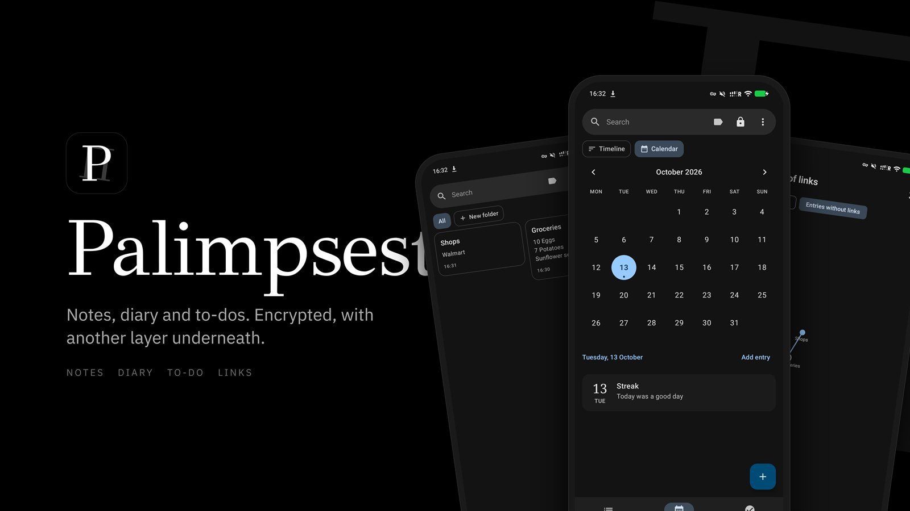
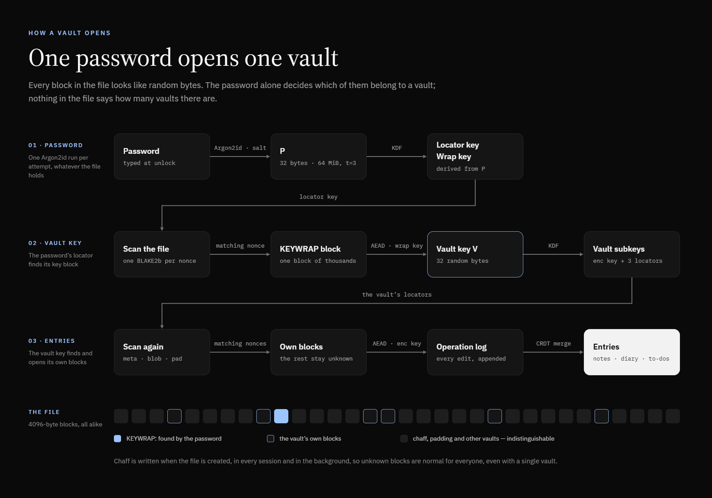

# Palimpsest

An encrypted diary and notes app for Android with **deniable vaults**: one password field,
any number of vaults, and no way to tell from the file how many there are.

[](https://github.com/tetogon/palimpsest/actions/workflows/ci.yml)
[](https://github.com/tetogon/palimpsest/actions/workflows/fuzz.yml)
[](LICENSE)



> **Experimental. Not audited.** Palimpsest protects against a curious partner, a thief and a
> quick border check. It does not protect against a forensic lab, spyware on the phone, or
> someone who will keep demanding passwords until they believe you. If an adversary gets the
> password of a decoy vault, even one copy of the file can give a hidden vault away by how
> much the file grew over its life; several copies from different moments do so more easily.
> Use the decoy more than the hidden vault. Details are in the
> [threat model](docs/threat-model.md) and the [T5 simulation](docs/t5-simulation.md).

## The idea

Every password opens its own vault. Type the decoy password and you get a believable diary;
type another and you get the real one. The app never knows which is which, and neither does
anyone holding the file:

- the container is a pile of 4096-byte blocks that all look like random bytes: no header, no
  signature, no version in clear;
- random **chaff** blocks are added on creation, in every session and in the background, so
  unrecognised blocks are normal for every user, even one with a single vault;
- a vault finds its own blocks through keyed locators in the nonces, so unlocking scans
  24 bytes per block instead of trying to decrypt everything;
- the app behaves the same whatever vault is open, and nothing outside the vaults depends on
  how many exist.




## Features

**Writing**
- Three sections: notes in a grid, a diary (timeline or month calendar with "on this day"),
  and to-dos. Swipe between them.
- Markdown editor with live styling. Markers like `**` and `#` hide except on the line
  you are editing. Formatting bar, alignment, and one undo history for the whole entry.
- LaTeX formulas, `$…$` in a line and `$$…$$` on their own, drawn natively in read mode
  and on the cards.
- Tables in the GitHub syntax, with column alignment, and code blocks highlighted by
  language (` ```kotlin `, ` ```python `, ` ```rust ` and a dozen more).
- Photos and voice notes. The in-app camera and recorder work in memory only, so nothing
  reaches the gallery. Photos are cropped and rotated before they are stored, and EXIF
  (including GPS) is dropped. Drag a photo into the text and place it left, centre or right
  in three sizes, with text beside it.
- Links between entries (type `[[`), backlinks, and a graph of links. In the graph you drag
  one entry onto another to link them, and again to unlink.
- Folders, tags, pins, colours, search with `#tag` filters, and search inside an entry that
  fades everything but the matches. A trash with 30-day expiry.

**Vaults**
- Create a vault, change its password, delete it (its blocks are overwritten with random
  bytes in place).
- A one-shot duress rule: "on the next opening of this vault, destroy the vault with
  password X". The rule stores only the target's locators, never its keys, and removes
  itself after firing.
- "Erase manually" mode: replaced revisions are kept until you ask, so two copies of the file
  do not reveal edits in a hidden vault through changed blocks. See the
  [T5 simulation](docs/t5-simulation.md).
- Backup of the whole container (all vaults, chaff included), restore (it asks for a password
  that opens a vault in the backup), and export of one vault into a separate file under a
  fresh vault key. Import merges newer entries.
- Sync without internet access: the whole container is kept in step with one file in Google
  Drive, Proton Drive, a Cryptomator vault or a Syncthing folder, reached through the system
  file picker. Copies merge by taking the union of their blocks, so no password is needed and
  hidden vaults sync without showing. "Merge with a copy" does the same once, by hand.
- Export of one vault as Markdown files in a ZIP, unencrypted, behind a clear warning.

**Android hygiene**
- No `INTERNET` permission. No WebView: Markdown is rendered natively.
- Screenshots and screen recording are blocked unless allowed in the settings. The recent
  apps preview is always hidden.
- Incognito keyboard flag and no autofill in every field. "Share", "Translate" and web search
  are removed from the text selection menu. Copied text is marked sensitive and cleared after
  60 s, or copying can be turned off entirely.
- Lock on screen off, after idle time and in the background. A fixed 1 s pause after every
  answer that tells whether a password opens a vault.
- Backup and device transfer are disabled. Plaintext never touches the disk outside the
  encrypted container.

## Syncing between phones

Palimpsest has no internet access, so it syncs through one file that another app moves for
it: Google Drive, Syncthing, a Cryptomator vault, or anything else that shows up in the
system file picker. Proton Drive's file picker support currently stalls on folder listings
and is not reliable for this.

**First phone**
1. Settings → Backup and transfer → **Sync with a cloud file** → **New file**.
2. Pick a folder in your drive and save. The file gets a neutral name such as
   `sync-20261112-1430.bin`.
3. Wait for "Synced", then let the drive app finish uploading the file.

**Every other phone**
1. Install Palimpsest and open it once.
2. Settings → Backup and transfer → **Sync with a cloud file** → **Existing file**, and pick
   the same file.
3. The app tells you the file holds another container: a new phone starts a container of its
   own, and only copies of one container can be merged. Choose **Replace with the sync file**
   and type the password of any vault in it. Vaults that exist only on this phone are lost, so
   export them first if you need them and import them afterwards.

From then on each phone syncs on its own: when the app starts, when a vault is unlocked or
locked, when you leave the app (at most every 15 minutes) and with **Sync now**. Sync needs no
password, merges every vault at once, and never shows which vaults exist. Edits made on two
phones before they sync are both kept; if they touched the same entry, the entry offers the
other version to merge by hand.

Good to know:
- Every upload is one more copy of the file, and drives keep old versions. With those copies
  and the password of one vault, an adversary can tell from the file's growth that another,
  hidden vault exists. Keep a hidden vault less active than the others. See the
  [threat model](docs/threat-model.md), R3 and R13.
- A vault destroyed on one phone (deleted, or by the wipe rule) stays destroyed there, even
  after syncing, but other phones you sync with still hold it.
- **Merge with a copy** (same settings section) does one sync by hand with any copy of the
  container, such as an older backup.

## How it is built

| Part | What |
|---|---|
| [`core-rs/`](core-rs) | The core in Rust: container format, crypto, operation log, purge, chaff, export and import. RustCrypto (`argon2`, `chacha20poly1305`, `blake2`), `zeroize` for keys and plaintext. Exposed to Kotlin through [UniFFI](https://github.com/mozilla/uniffi-rs). |
| [`app/`](app) | The Android app in Kotlin and Jetpack Compose (Material 3). |
| [`core/`](core) | A reference implementation in Kotlin on libsodium. It only produces the [test vectors](test-vectors) that keep the Rust core byte-identical to libsodium. |
| [`docs/`](docs) | [Container format](docs/format-spec.md), [threat model](docs/threat-model.md), [T5 simulation](docs/t5-simulation.md), [roadmap](docs/roadmap.md). |

Crypto at a glance: Argon2id (64 MiB, t=3) per unlock attempt, XChaCha20-Poly1305 for every
block with the container salt in the associated data, BLAKE2b for key derivation and
locators. Entries are an append-only log of operations merged as a CRDT, with last writer
wins and explicit ancestry.

## Building

You need JDK 17, the Android SDK with NDK `27.2.12479018`, Rust with the Android targets,
and [`cargo-ndk`](https://github.com/bbqsrc/cargo-ndk):

```sh
rustup target add aarch64-linux-android armv7-linux-androideabi x86_64-linux-android
cargo install cargo-ndk --version 4.1.2 --locked
export ANDROID_NDK_HOME="$ANDROID_HOME/ndk/27.2.12479018"
./gradlew :app:assembleRelease
```

Gradle builds the Rust core for all three ABIs and generates the Kotlin bindings itself.
Tests:

```sh
(cd core-rs && cargo test)
./gradlew :app:testReleaseUnitTest
```

The core's parsers and whole crafted vaults are fuzzed with libFuzzer (Linux or macOS,
nightly Rust; see [threat model, G6](docs/threat-model.md#g6-crafted-vaults-do-not-crash-the-app)):

```sh
cd core-rs && cargo +nightly fuzz run vault
```

On Windows, [`scripts/env.ps1`](scripts/env.ps1) sets up portable toolchains and works around
non-ASCII project paths.

Without a `keystore.properties` the release APK comes out unsigned; `./gradlew :app:assembleDebug`
gives an installable debug build.

## Verifying an APK

To check that an APK is genuine, compare its signing certificate:

```sh
apksigner verify --print-certs palimpsest-vX.Y.Z.apk
```

```
SHA-256: 4e79c9360ba7e8ab2449ad243a0eaa2296bd74d7224412ff8e49e507e4d37b8b
```

## License

Palimpsest is free software: you can redistribute it and/or modify it under the terms of the
[GNU General Public License](LICENSE) as published by the Free Software Foundation, either
version 3 of the License, or (at your option) any later version (`GPL-3.0-or-later`).
