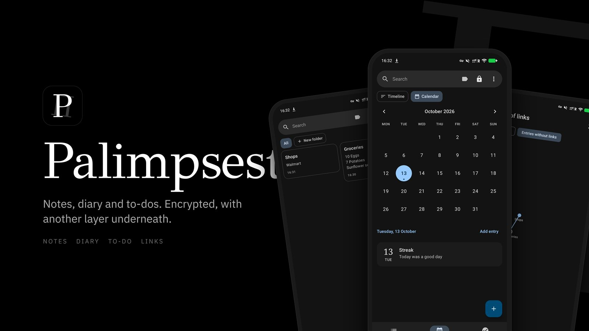
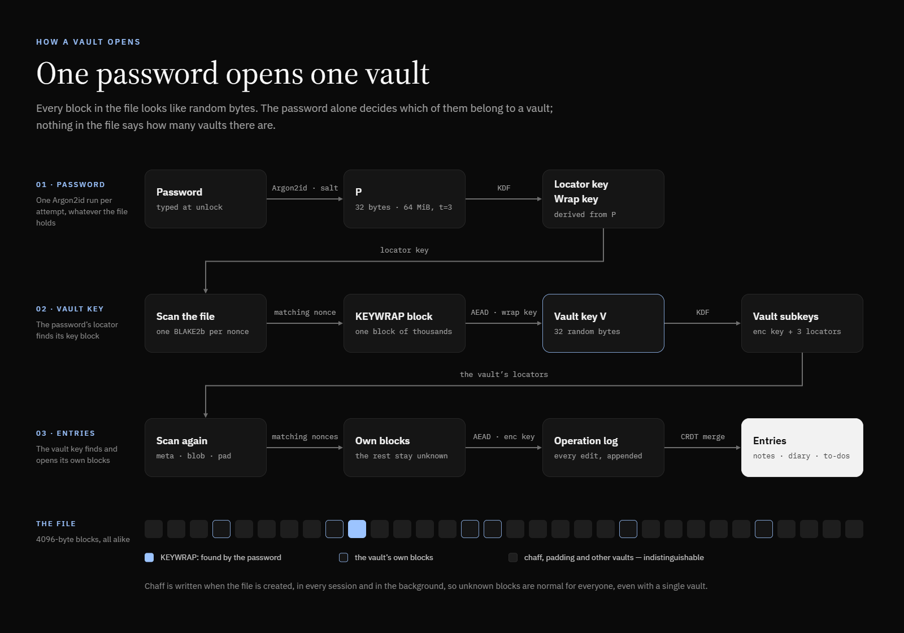

# Palimpsest

An encrypted diary and notes app for Android with **deniable vaults**: one password field,
any number of vaults, and no way to tell from the file how many there are.

[](https://github.com/tetogon/palimpsest/actions/workflows/ci.yml)
[](LICENSE)



> **Experimental. Not audited.** Palimpsest protects against a curious partner, a thief and a
> quick border check. It does not protect against a forensic lab, spyware on the phone, or
> someone who will keep demanding passwords until they believe you. If an adversary keeps
> copies of the file from different moments and knows the password of a decoy vault, a
> hidden vault can give itself away. Details are in the [threat model](docs/threat-model.md).

## The idea

Every password opens its own vault. Type the decoy password and you get a believable diary;
type another and you get the real one. The app never knows which is which, and neither does
anyone holding the file:

- the container is a pile of 4096-byte blocks that all look like random bytes: no header, no
  signature, no version in clear;
- random **chaff** blocks are added on creation, in every session and in the background, so
  unrecognised blocks are normal for every user, even one with a single vault;
- a vault finds its own blocks through keyed locators in the nonces, so unlocking scans
  24 bytes per block instead of trying to decrypt everything;
- the app behaves the same whatever vault is open, and nothing outside the vaults depends on
  how many exist.




## Features

**Writing**
- Three sections: notes in a grid, a diary (timeline or month calendar with "on this day"),
  and to-dos. Swipe between them.
- Markdown editor with live styling. Markers like `**` and `#` hide except on the line
  you are editing. Formatting bar, alignment, and one undo history for the whole entry.
- Photos and voice notes. The in-app camera and recorder work in memory only, so nothing
  reaches the gallery. Photos are cropped and rotated before they are stored, and EXIF
  (including GPS) is dropped. Drag a photo into the text and place it left, centre or right
  in three sizes, with text beside it.
- Links between entries (type `[[`), backlinks, and a graph of links. In the graph you drag
  one entry onto another to link them, and again to unlink.
- Folders, tags, pins, colours, search with `#tag` filters, and search inside an entry that
  fades everything but the matches. A trash with 30-day expiry.

**Vaults**
- Create a vault, change its password, delete it (its blocks are overwritten with random
  bytes in place).
- A one-shot duress rule: "on the next opening of this vault, destroy the vault with
  password X". The rule stores only the target's locators, never its keys, and removes
  itself after firing.
- "Erase manually" mode: replaced revisions are kept until you ask, so two copies of the file
  do not reveal edits in a hidden vault through changed blocks. See the
  [T5 simulation](docs/t5-simulation.md).
- Backup of the whole container (all vaults, chaff included), restore, and export of one
  vault into a separate file under a fresh vault key. Import merges newer entries.

**Android hygiene**
- No `INTERNET` permission. No WebView: Markdown is rendered natively.
- Screenshots and screen recording are blocked unless allowed in the settings. The recent
  apps preview is always hidden.
- Incognito keyboard flag and no autofill in every field. "Share", "Translate" and web search
  are removed from the text selection menu. Copied text is marked sensitive and cleared after
  60 s, or copying can be turned off entirely.
- Lock on screen off, after idle time and in the background. A fixed 1 s pause after every
  answer that tells whether a password opens a vault.
- Backup and device transfer are disabled. Plaintext never touches the disk outside the
  encrypted container.

## How it is built

| Part | What |
|---|---|
| [`core-rs/`](core-rs) | The core in Rust: container format, crypto, operation log, purge, chaff, export and import. RustCrypto (`argon2`, `chacha20poly1305`, `blake2`), `zeroize` for keys and plaintext. Exposed to Kotlin through [UniFFI](https://github.com/mozilla/uniffi-rs). |
| [`app/`](app) | The Android app in Kotlin and Jetpack Compose (Material 3). |
| [`core/`](core) | A reference implementation in Kotlin on libsodium. It only produces the [test vectors](test-vectors) that keep the Rust core byte-identical to libsodium. |
| [`docs/`](docs) | [Container format](docs/format-spec.md), [threat model](docs/threat-model.md), [T5 simulation](docs/t5-simulation.md), [roadmap](docs/roadmap.md). |

Crypto at a glance: Argon2id (64 MiB, t=3) per unlock attempt, XChaCha20-Poly1305 for every
block with the container salt in the associated data, BLAKE2b for key derivation and
locators. Entries are an append-only log of operations merged as a CRDT, with last writer
wins and explicit ancestry.

## Building

You need JDK 17, the Android SDK with NDK `27.2.12479018`, Rust with the Android targets,
and [`cargo-ndk`](https://github.com/bbqsrc/cargo-ndk):

```sh
rustup target add aarch64-linux-android armv7-linux-androideabi x86_64-linux-android
cargo install cargo-ndk --version 4.1.2 --locked
export ANDROID_NDK_HOME="$ANDROID_HOME/ndk/27.2.12479018"
./gradlew :app:assembleRelease
```

Gradle builds the Rust core for all three ABIs and generates the Kotlin bindings itself.
Tests:

```sh
(cd core-rs && cargo test)
./gradlew :app:testReleaseUnitTest
```

On Windows, [`scripts/env.ps1`](scripts/env.ps1) sets up portable toolchains and works around
non-ASCII project paths.

Without a `keystore.properties` the release APK comes out unsigned; `./gradlew :app:assembleDebug`
gives an installable debug build.

## Verifying an APK

To check that an APK is genuine, compare its signing certificate:

```sh
apksigner verify --print-certs palimpsest-vX.Y.Z.apk
```

```
SHA-256: 4e79c9360ba7e8ab2449ad243a0eaa2296bd74d7224412ff8e49e507e4d37b8b
```

## License

Palimpsest is free software under the [GNU General Public License v3.0](LICENSE).
